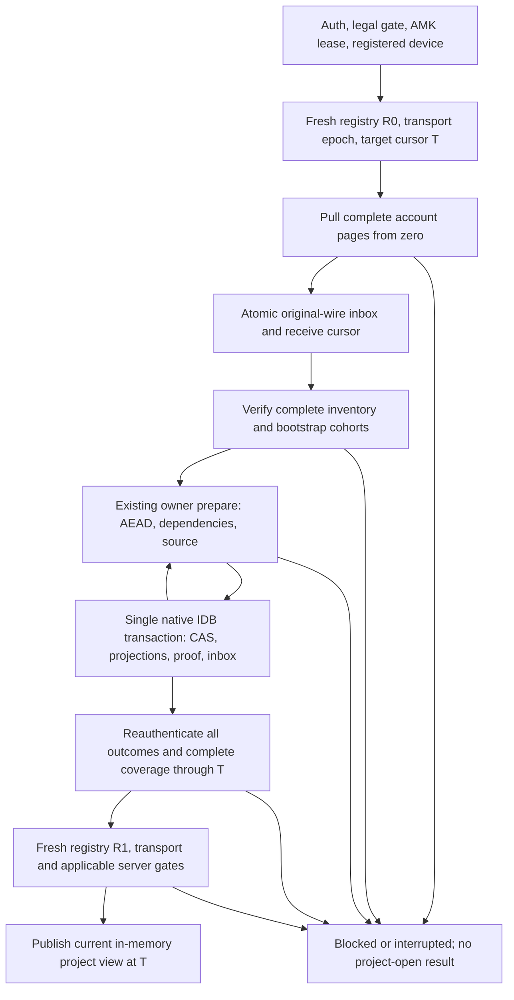

# WEB.ONLINE.02B — C21 Online-Only source/proof contract

**Status: DESIGN COMPLETE. Slices 1/2/3A/3B independently accepted; slice 3C initial Legacy Note owner replay implemented locally. Later slices remain deferred.**
The original design review used clean `6.0` baseline
`57abb27ed712378a836ba654bc3c1c107ac804d5`, 2026-10-28, and introduced no
production code or migration. Subsequent explicitly authorized implementation
records follow. No capability, writer, ACK or release activation is authorized.
The preceding implementation at `3ef704c5` was independently accepted by
owner-reported Cloud run `40578946929`, 6/6 SUCCESS. No CI was queried here.

**Implementation record, 2026-10-28:** the owner subsequently authorized slice 1
on baseline `a092ed2e84ceb18836d83dbec7118e060d8d07f4`. The new separate
`worta-web-replay` schema1 has 13 stores and permits only received inbox/technical
cursor/manifest state plus mirrored technical identity. Owner/source/outbound
stores remain empty. The explicit session receiver reads all account events in
pages, atomically stages them through `BrowserSyncDurability`, revalidates the
entire retained prefix against fresh server wire on resume, and requires final
registry/mode equality before returning a ciphertext-receipt summary. Prefix
comparison is read-only source reconciliation; it does not extend J's interval
replay or grant a certificate. No source/cohort/AEAD owner verification or project
opening is claimed. The 200-event, ciphertext and aggregate inventory limits are
enforced; rollback/lineage drift and unknown schemas reject. V12 and legacy data
are untouched. Final local prepush passed: 501 Vitest/18 files, typecheck/build,
six frontend Chromium scripts (17 new native storage scenarios), 263 backend
tests including the 10-scenario real Chromium/API/PostgreSQL receiver test, and
one encrypted-blob/PostgreSQL backup/restore. Changed ESLint and diff/static
checks passed; independent CI is pending and was not polled. The
original design sections below distinguish the future full owner composition
from this implemented receipt-only layer. Future owner records must have an
explicit schema/record compatibility decision before v1's received-only refusal
is broadened. No later slice is implicitly authorized.

## Slice 2 implementation record — WEB.ONLINE.02B.02, 2026-10-28

Starting `6.0` SHA `bdfb5601d2d4b512fc76e424c5b0db1ae87dc67c` was clean.
Owner-reported independent run **40601063694: 6/6 SUCCESS** accepts slice 1 at
that SHA. The historical slice-1 “CI pending” statements above describe its
publication state; this record supersedes them. No Actions polling occurred.

### Compatibility decision and exact record authority

Replay schema **v2** retains the same thirteen physical stores/key paths/indexes.
Only manifest record/contract versions become 2, adding `metadata_cursor`:
a contiguous account-prefix *derived journal*, never an ACK, source revision,
owner certificate, `proven_prefix`, or opening authority. Native versionchange
validates all accounts and all v1 records before any manifest update. Ciphertext,
nonce, wire/receive protocol, identities, generation, cursors and other records
are preserved byte-for-byte. An interrupted/quota/corrupt migration aborts the
entire upgrade, including native database version. Genuine pinned v1 code refuses
v2. Unknown versions/schemas refuse without cleanup. No `worta-web` v12, SQLite
or PostgreSQL schema/data migration is part of this slice.

The runtime admits exactly received inbox record1 and real Metadata applied
record2, existing `BrowserProjectBinding` import records and existing Metadata
owner heads. All source/outbound/receipt/Note compatibility stores remain empty.
Validation joins every applied inbox proof to the exact head history and every
head to an active imported binding/bootstrap, and checks the whole dense prefix.
Merely allowing nonempty stores is insufficient: pre/post owner transactions
validate all thirteen stores, full expected inventory, generation and exact
permitted record delta under the existing aggregate size bounds.

`BrowserCloudAccountSession.applyCloudAccountMetadata()` first uses the slice-1
receiver, holding its writer lease through server reconciliation and owner apply.
The full account history must be supported Metadata-only before applying any new
event; there is no project filtering or jumping over unsupported earlier events.
Fresh registry/mode equality and an empty tail pull through the real device/family
gates are required before each owner write and again before publishing a result.
Account/device identity, auth epoch, AMK lease, replay generation and cancellation
are rechecked throughout. No automatic startup, UI action or capability change.

The genuine `BrowserImportedMetadataApply` already supports first create with a
proper import binding. Its new narrow genesis preparation authenticates active
registry/origin/bootstrap and the real AEAD genesis, then mints the same private,
owner-bound plan. Existing `BrowserProjectBindings.importRemote` record preparation
is shared, with no local project or source creation. The private owner commit adds
the import binding **with** the real head and inbox applied proof; the adapter adds
the derived manifest journal in that same strict native transaction. Subsequent
updates use the existing transition, parents/tips/revision/generation and retained
wire checks. No new reducer, source/bootstrap seed owner, fake source revision,
new proof format or protocol change was needed. Historical handoff's pre-existing
head requirement remains unchanged.

Real API integration exposed a representation mismatch: server descriptor time
`…00Z` and canonical AEAD header time `…00.000000Z` represent the same instant.
The owner now uses the existing full-microsecond timestamp comparison contract,
as the existing preview does. Proof references and their digest retain original
server spelling. Invalid time and even one microsecond of actual drift reject;
there is no rounding, wire rewriting or reduced identity check.

Every success reloads durable records and reauthenticates real Metadata prefix
proofs using `prepareMetadataPrefix(force=true)`. Restart repeats authorization,
AMK unlock, zero-origin exact server-wire reconciliation, registry/mode/device
gates and owner-proof AEAD verification. Already applied rows are not rewritten.
A lost commit response is an error to its stale caller; a later fresh call reads
and reauthenticates the real committed outcome, then continues at the next event.
Quota/abort/context loss before commit rolls back binding/head/proof/journal
atomically. Corrupt matching head/inbox proof DTOs are not valid certificates.

### Deliberate cohort and publication boundary

Supported: bounded (200 events / 32 MiB) Metadata-only account snapshots, active
bootstrap, coverless peer-origin create and linear updates, multiple projects
and pages. The whole supported chain is authored by the registered bootstrap
origin, distinct from this browser's device. Other source devices, self-echo,
missing parents, conflicting tips, cover/delete/unsupported generation or family
refuse. Valid already committed prefix proofs may remain after a later event
fails; no failed event gains an applied proof and no partial project is exposed.

If the server snapshot advances after owner records exist, this slice refuses
`stale_authority` and preserves those records. It does **not** clear owned proofs
using slice-1's owner-free cache rebuild. A future separately accepted refresh/
structural adapter must define advancement; this task implements no later slice.

The diagnostic result is `metadata_owner_applied` with the actual owner-proof
count, **projectOpened=false** and every readiness/writer flag false. It exposes
no project plaintext projection. The original receipt-only API still means
`received_ciphertext` / `ownerProofs=0`; it refuses `metadata_owner_state_present`
on an owner-bearing generation instead of mislabelling it. Full project open,
Notes/Maps/Documents/Stage editing, source seed, ACK/push/capabilities/writer/
cutover and public release remain blocked. Existing Metadata-only preview stays
unchanged. Server authority, E2EE/AEAD and the frozen C21 formats are retained.

Local acceptance **PASS**: full prepush with 631 Vitest/23 files, typecheck/
build, six frontend Chromium scripts, 264 isolated PostgreSQL backend tests and
one real backup/restore. The new API/Chromium owner test has **47 scenarios**,
including genuine 102-event history, migration rollback, native restart and
forbidden-write warm replay; existing 17 storage and 10 receiver API scenarios
remain. ESLint/YAML/shell/Python/diff and six-job configuration checks pass.
No local Linux/x86-64 frontend acceptance is claimed. Independent CI of the
new commit is **PENDING**. Official progress remains **89.36%**. Next authorized
slice remains 3's structural/source foundation, one bounded owner cohort at a
time, including an explicit owned-generation advancement decision before
accepting a changed server snapshot. Recommended model: **GPT-6 Sol / High**.

## Slice 3A implementation — 2026-10-28

Owner-reported slice-2 acceptance: `3cb31ff`, run **40610547517 — 6/6 SUCCESS**.
`BrowserStageApply` and `BrowserStageOrderApply` now join the same account-feed
composition and actual strict transaction adapter as Imported Metadata.
Replay v3 keeps the thirteen stores and original Metadata proof formats;
v2→v3 validates/preserves every old record and adds manifest `applied_cursor`
initialized from the genuine v2 prefix. Direct v1→v3 receipt migration remains.
`metadata_cursor` still denotes only the initial Metadata-only account prefix.
Mixed derived coverage must exactly join real inbox2/5/6 proofs and corresponding
owner histories with earlier dependency sequences. Neither journal authorizes
ACK/readiness/opening. Force-reauthentication uses all three existing owners'
certificates; full inventory/generation CAS and fresh server/device gates remain.
Stage membership must be complete before its first StageOrder; later new Stage
identities are a rejected cohort under current full-membership reauthentication.
Existing Metadata-only entry/result remains restricted; the new diagnostic is
`structural_owners_applied`, always `projectOpened=false` and all readiness/
writer flags false. V12, SQLite/PostgreSQL, UI and source stores are untouched.
Local prepush passed: 798 Vitest/28 files, typecheck/build, six frontend browser
scripts, 265 backend tests and real backup/restore. New Structural API acceptance
has 43 genuine Chromium scenarios, including exact readonly winner restoration,
v2/v3 migration and both owner families' rollback/reauthentication. Existing
Metadata acceptance remains; independent new-commit CI is pending. 03B remains
necessary: private encrypted seed from authenticated origin/cohort/mapping and
real owner evidence, never ordinary local CRUD or synthetic source revisions.
No full project, Note owner, writer, ACK, declaration or release is authorized.

## Slice 3B implementation — 2026-10-28

Owner-reported independent acceptance of 03A: `57abfbc785c9e8c849e2b6fbc9f78208ab7b47a8`,
run **40675867782 — 6/6 SUCCESS**. A concurrent, published documentation commit
`77a8d349` introduced the six user-facing MVP stages in the checkpoint; this
source seed is a bounded internal step within stage 2.

Replay **v4** uses the existing `localProjects` store only for an encrypted,
initial empty Note source. The manifest gains `source_seeds` references to the
active bootstrap, origin, genuine Metadata genesis and initial Legacy Note
count/max sequence. Source record validation and a strict manifest/source join
reject extra or missing records; other compatibility stores remain empty.
V1/v2/v3→v4 native upgrade validates complete old inventories and rewrites only
manifest versions/fields. Received ciphertext and all real Metadata/Stage/
StageOrder proof records remain unchanged. Failed/quota upgrades roll back the
native version and bytes. A genuine pinned v3 client refuses v4. No migration of
developer `worta-web` v12, SQLite or PostgreSQL occurs.

The private owner reads only the complete server-reconciled account history,
authenticates active bootstrap and full initial Legacy Note cohort with the
existing Note transport codec, and authenticates the genuine Metadata genesis
and supported linear Metadata history with the existing Metadata codec/proof
rules and transient shared head validator. Fork/delete, foreign Metadata source
and Note material beyond the initial cohort reject. Notes before genesis are permitted
for seed evidence; they do not gain Metadata dependency or applied status.
Project fields derive only from genesis; the empty source has revision 1 and
`payload={}`. Existing AMK local-source seal/open helpers encrypt it. The
replay adapter checks fresh registry, transport and empty server tail, then
commits source plus reference in a single strict transaction after full
inventory/generation CAS. Server/session/key checks and source/proof AEAD
reauthentication run again after commit and on restart. Duplicate calls do not
rewrite; a lost response is reconciled by reopening genuine durable state.

The result `encrypted_note_source_seed` keeps `projectOpened=false` and all
readiness/writer flags false. No Note event is applied, no owner proof or cursor
is fabricated, and no ACK, push, capability or UI path is enabled. Unsupported
bootstrap/cohort, ciphertext, source mutation, registry drift, missing history,
logout and key loss fail without a new seed. Existing C21 Note owners still need
their own per-event source/history/proof commits. In particular the earlier
Legacy Note events cannot be declared applied merely because the later Metadata
genesis was authenticated for seeding. Full project opening remains blocked.

Local evidence: focused **18 seed Vitest**, real Chromium/FastAPI/PostgreSQL
**19 scenarios** over 104 genuine events/two projects, full prepush **816 Vitest/
29 files**, 266 isolated PostgreSQL
backend tests, typecheck/build and encrypted-blob backup/restore. Changed ESLint,
workflow/static and diff checks pass. Independent new-commit CI is pending;
Linux/x86-64 is not locally established.

## Slice 3D implementation — 2026-10-29

Owner-reported independent run **40820462050 — 6/6 SUCCESS** accepts 03C SHA
`7f29c55b9b943a9087eafbe81a8b05836a8e5ced`. A subsequent documentation-only
commit `d1aa18d9255fa21c1b3fe64829de6c3f4cb26560` did not change code.

The source seed still derives exactly the original bootstrap Note cohort by
`initial_max_server_sequence` and verifies its count, origin and encrypted
creates. Later Note events no longer alter that membership. The whole-account
composer admits only updates of Note IDs already present in that cohort, from
the supported origin device. It invokes the existing `BrowserLegacyNoteApplyRuntime`
in server order; its clean causal path verifies parent, revision, current source,
retained candidate and genuine owner outcome. Fork/conflict results are rejected
by the replay adapter rather than being promoted to an applied proof.

The v4 inventory retains one immutable encrypted candidate per applied event,
one current head and encrypted Note row per Note ID, plus the full proof chain.
It joins each update to its exact prior event and source revision, checks the
latest candidate against the current Note row and permits only the owner's
single-event atomic delta. Reauthentication opens every retained candidate,
checks its AEAD/projection and proof, authenticates the unchanged seed and
decrypts the current source through the readonly local owner. Fresh full server
reconciliation remains mandatory before any result. No new record format,
physical store or migration is introduced; `worta-web-replay` stays **v4**.

Real Chromium/FastAPI/PostgreSQL 16 acceptance passed **19 scenarios** with
genuine producers, two projects, multi-update chains, restarts, quota rollback,
lost commit response, corrupted source/history/proof and wrong-parent,
revision-gap/fork, lock/logout and changed-wire refusals. Full local prepush
passed 816 Vitest, 268 PostgreSQL tests, six Chromium scripts, build and
backup/restore. 03D does not support deletion, Content Note,
Resolution, complex conflicts or full project opening. All negative security,
writer and release gates remain; new independent CI is pending.

## 03E — supported Legacy Note tombstone replay

03E adds only peer-origin delete events for Notes already present in the
authenticated initial Legacy Note cohort. The account-wide receiver continues
to validate the entire server history in sequence; it does not filter later
events around an unsupported family. For a Note, a delete descriptor must
carry a tombstone timestamp and follow that same Note's live prior event with
the next owner revision. The initial cohort remains create-only. A delete
cannot be repeated, and no event after a delete is admitted by this slice.

`BrowserLegacyNoteApplyRuntime` remains the only reducer/authority for the
delete. Its normal prepare/commit validates AEAD, original wire/header,
account/project/source identity, causal parent and tombstone projection. The
existing transaction atomically commits encrypted Note/source projection,
candidate, head/history, inbox `note_proven` and derived contiguous coverage.
The replay adapter admits only this exact owner delta in the full-inventory
CAS and later reauthenticates it against the retained ciphertext and server
snapshot. Repeated replay and restart validate existing proofs without
duplicating them. Failed or interrupted commits leave the prior state intact.

The physical `worta-web-replay` schema remains **v4** with its existing stores
and proof formats; no migration, SQLite, IndexedDB developer-v12 or PostgreSQL
schema change is introduced. Genuine producer tests exercise two projects,
two tombstoned Notes and one still-live Note alongside sequential updates.
Content Notes, Resolution, resurrection, complex conflict branches and full
project opening remain unsupported. No ACK, capability declaration, push,
writer activation or `projectOpened` success is produced by this slice.
Real Chromium/FastAPI/PostgreSQL 16 acceptance passed 23 scenarios, including
genuine encrypted malformed deletes for wrong parent, revision gap, unknown
Note ID and repeated deletion; each remains unproven and the prior committed
state is preserved. Full prepush passed 816 Vitest, 269 PostgreSQL tests, six
Chromium scripts, typecheck/build and backup/restore.

## Slice 3C implementation — 2026-10-28

Owner-reported independent acceptance of 03B: `7fdcde1515a3eb777c0eef27a7b97e03a8bc95ac`,
run **40734155479 — 6/6 SUCCESS**. The next bounded cohort is ordinary initial
Legacy Note creates only. `applyCloudInitialNotes()` reuses the complete account
receiver and strict server-order replay; a Note at sequence 1 must be genuinely
applied before a later Metadata genesis at sequence 4 can advance coverage.

The only early admission is a technical `import_remote` binding derived from the
03B authenticated source seed and a freshly checked active registry/transport/
server tail. Admission is CAS-protected and does not create an owner proof or
advance either cursor. `BrowserLegacyNoteApplyRuntime.prepare/commit` then
authenticates the original Legacy wire and writes its existing source, local
Note, candidate/head history and inbox `note_proven` proof atomically. The
replay adapter adds only derived coverage in the same IndexedDB transaction.
Imported Metadata and Stage/StageOrder keep their original owner/proof paths.

The isolated physical replay database remains **v4** with the same thirteen
stores and manifest shape: Note records already had dedicated stores and the
genuine owner proof format. The strict inventory now permits only initial
peer-origin `create` outcomes tied to exact source seed, bootstrap, server
sequence, original wire, source revision and one encrypted projection per Note.
It still forbids outbox, receipts and intents. Existing v1/v2/v3 migration
paths retain their prior checks and no v12/SQLite/PostgreSQL migration occurs.
Old v4 code with its empty-Note-store invariant refuses a Note-bearing cache;
it cannot silently treat the new state as an empty source.

On restart, a fresh full server comparison precedes owner reauthentication.
The source is opened with the existing readonly local authority and checked
against authenticated Metadata genesis; every retained Note proof is checked
against AEAD wire and its history candidate/projection. A lost response after
commit can resume from the next unproven event. Quota, missing rows, damaged
wire/source/history/proof, foreign identity, registry drift, lock and offline
state cannot create a false applied result. `initial_legacy_notes_applied`
reports genuine Note and Structural proof counts but always
`projectOpened=false`. No general Note update/delete, Content, Resolution,
conflict or fork support is claimed. No ACK, capability, push, writer or UI
opening is activated. C21/C22/C23/PF6.0/RC and all negative gates remain.

LOCAL-FIRST passed: **816 Vitest / 29 files**, typecheck/build, six existing
frontend Chromium scripts, **267 isolated PostgreSQL backend tests**, one
encrypted-blob backup/restore and the new **23-scenario** genuine
FastAPI/PostgreSQL/Chromium Note replay acceptance. The latter covers two
projects, three Legacy creates before Metadata, real Stage/StageOrder proofs,
restart between Notes and after completion, quota/key rollback, lost response,
corrupt wire/source/history/proof and server/offline refusal, with no plaintext
storage or reader write requests. Final focused **91 Vitest / 4 files**,
changed-file ESLint, syntax and diff checks passed. Linux x86-64 was not run
locally; independent CI of the new commit is pending.

## 1. Decision and authority

Use the existing encrypted account transport and C21 owners with an isolated,
durable, encrypted **replay cache**. The server remains authoritative for uploaded
user data. The cache is a reconstructible projection and transaction journal;
it cannot create a project, accept a local edit, publish an event, or authorize
an offline project opening. Loss of the cache requires server replay, never
recovery from an unrelated developer workspace.

This resolves the storage-policy question raised by WEB.ONLINE.02A: durable
owner evidence and Online-Only operation are compatible when browser storage
is derived, isolated and freshly checked against the server. Existing owners
still lack production composition and several family implementations. This
document does not remove those implementation barriers or approve full reading.
At the design baseline it proposed a storage boundary; the subsequent explicit
slice-1 task authorized its receipt-only implementation under `AGENTS.md`.
Further owner/content stores or behavior still require their own task.

Desktop keeps its SQLite source and optional sync. Existing `worta-web` v12,
local projects/stages/Notes/Documents and historical proofs remain untouched.
No implicit import, merge, promotion, cleanup or v12-to-production migration.
Reuse the existing account identity service, account binding and runtime AMK
lease for technical identity; do not create another key or copy credentials.

The contract covers synchronized history only. Unsent Desktop edits, local-only
entities and source-device private counters cannot be restored from the server.
Whole-account history means every retained sequence through a pinned cursor,
including other projects and account-scoped events. It does not mean that every
history is supported by today's owners. A limit or unsupported record blocks
opening; it cannot produce a partly restored project labelled complete.

## 2. Evidence and owner readiness matrix

Paths below are current implementations, not proposed APIs. `LOCAL` means a
bounded owner exists, not production Online-Only readiness. `NATIVE` means its
apply transaction executes in Rust/SQLite through Tauri and cannot run directly
in a normal browser. AEAD/codecs alone never establish an applied outcome.

| Owner / status | Required history and dependencies | Durable application evidence today | Reuse and missing production work |
| --- | --- | --- | --- |
| Metadata preview — implemented | `cloudRead.ts`, `canonicalReaders.ts`, `metadataImportSnapshot.ts`: complete bounded account feed, bootstrap, exact descriptor/header joins, causal Metadata history | None; returned Metadata is a read-only view, not apply proof | Reuse transport, AEAD and reducer unchanged. Keep preview distinct from all project-read results. Covers, unsupported families, conflicts and deleted head reject. |
| Imported Metadata — LOCAL | `importedMetadataApply.ts`, `metadataPrefixProof.ts`: original inbox wire, import binding, full Metadata parents/tips, bootstrap, no incompatible local publication | Metadata `ownerHeads` history plus `inbox.applied_proof`, committed together | Slice 2 now composes this real owner through replay v2 for the bounded peer-origin, coverless ordinary chain; see its implementation record above. This is narrower than all forms accepted by the preview reducer. Private post-F handoff has its own source/inventory checks. |
| Stage — LOCAL | `stageApply.ts`: Metadata proof/certificate, same project/bootstrap, exact parent/tip/revision and original peer wire | Stage owner head plus inbox record5 `stage_proven`, one transaction | Reuse existing create/update/read owner. Delete, self-echo and competing heads are barriers; Stage codec support does not remove these limits. Mixed v10 admission still needs complete-inventory guarding. |
| StageOrder — LOCAL | `stageOrderApply.ts`: Metadata plus all Stage heads, ancestry coverage and exact membership; unapplied Stage rows and tombstones are checked | StageOrder owner head plus inbox record6 `stage_order_proven` | Reuse existing owner. Missing/foreign Stage, changed membership, tombstone child manifest and unsupported history block. |
| Legacy ordinary Note — LOCAL | `noteTransport.ts`, `legacyNoteApply.ts`, `localAuthority.ts`: Legacy plaintext codec over original v2/v3 receive identity, initial cohort, causal candidates/head, membership, source CAS, real own receipts if needed | Encrypted project/Note source, candidate/head history, applied/conflict inbox proof and source revision in the owner's transaction | Reuse source/causal/historical kernels extracted by Z2B1/B2/B2C. Cache-only replay seeding below is not implemented; historical Z2A virtual-inventory/batch work is also unfinished. Do not call local CRUD to manufacture authority. |
| Content Note v3 — LOCAL; native reader also exists | `contentNoteApply.ts`, `noteTransportPrerequisite.ts`: canonical codec8, Metadata/Stage ancestry, route identity, causal and source rules | Candidate/transport/dependency joins, encrypted source and Content inbox proof committed by the actual owner | Reuse browser owner for its accepted cohort. `cloud/contentNoteReader.ts` defaults to native apply. Unsupported routes, conflicts and own Content evidence stay explicit barriers. |
| Note Resolution and descendants — LOCAL, bounded | `resolutionPlanner.ts` (including `BrowserResolutionApplyRuntime`), continuation, ordinary and prefix owners: all parents, conflict publications/closure, source-before/after, output identities, dependencies and immutable wire | Resolution4, GroupTransition2, encrypted output/source evidence, Head2 and inbox10 ResolutionProof1; actual F/H/O commits only | Preserve separate legacy-v2, raw Legacy-on-v3 and codec8 Resolution routes. Dedicated Legacy3 F/H/O/G/Q surfaces exist; default K still rejects relevant Legacy3 cohorts. Additional chains and broader source cohorts are not generally accepted. |
| V10 transport/recovery — dormant | `v10Transport.ts`, `v10Recovery.ts`, `v10MixedRecovery.ts`: complete local inventory, exact received interval, earliest pending event, gaps, source witnesses and supported binding | J verifies existing inbox and committed interval; K invokes atomic owners, may advance a local qualified prefix | Reuse within exact accepted cohorts. J is not an HTTP receiver, and K is not a complete production dispatcher. Never replace default binding with the most permissive dormant binding. |
| Maps — NATIVE | `cloud/mapSyncRuntime.ts`, Rust `map_sync.rs` / `map_codec.rs`: retained inbox, parents, Metadata/Stage authority, map/node/Note-link identities and conflict rules | `cloud_map_events`, `cloud_map_apply_ledger`, owner/projection state and exact received ciphertext | Shared codec can run in Web. Browser apply owner/storage adapter is absent; native `invoke()` cannot be wired into Web. Share the existing owner planning logic, then prove browser parity. |
| Documents — NATIVE | `cloud/documentSyncRuntime.ts`, Rust `document_sync.rs` / `document_codec.rs`: retained inbox, document scope/parents, Metadata/Stage proofs, valid Tiptap structure/extensions | `cloud_document_events`, `cloud_document_apply_ledger` and projection/owner state | Local v12 Tiptap documents are not server owner evidence. Need shared native owner kernel plus browser transaction/projection adapter; no plaintext document API. |
| Progress — NATIVE | `cloud/progressSyncRuntime.ts`, Rust `progress_sync.rs`: parents/facts, Metadata unit and Stage ancestry, conflicts and exact event identity | `cloud_progress_events`, `cloud_progress_apply_ledger`, derived chains/projection | Port the owner boundary through shared planning code, retaining fact/amount/causal validation. Do not derive history from current UI totals. |
| Project/Account Game — NATIVE | `cloud/gameSyncRuntime.ts`, Rust `game_sync.rs`: authenticated Progress/Metadata/Stage and project/account actions, stable reward IDs, deduplication, rules and compensation dependencies | `cloud_game_events`, `cloud_game_apply_ledger`, atomic project/account projections | Need shared owner computation and browser durable adapter. Replay must not grant rewards again or run outbound compensation/writer flows. Account Game uses account crypto, project Game uses project crypto. |
| Account catalog — NATIVE | `cloud/accountObjectReader.ts`, `accountCatalogRuntime.ts`, Rust `account_catalog.rs`: folder/order/membership/project-order ancestry, folder/project coverage and present authority | `cloud_catalog_events`, `cloud_catalog_apply_ledger`, account inbox and catalog state | A real native apply owner exists; authentication-only probe deliberately returns no apply authority. Need browser equivalent using shared owner logic, including cross-family dependencies; cannot omit account events. |
| Cover material — not composed in Web | Metadata cover reference, `projectCoverReference.ts`, `projectCoverCrypto.ts`, encrypted cover API and native cover repository | Existing native cover/reference authority; no accepted complete Web cover lifecycle | Reuse crypto/reference validation. Any referenced unavailable/unverified cover blocks the full-project claim until a browser owner is accepted. Do not drop it from Metadata. |

Native ledgers contain canonical frames/projections. Copying those plaintext SQL
layouts to IndexedDB is forbidden. Future browser adapters must retain original
AEAD wire and encrypt every content-bearing derived record using existing AMK
object/local-source encryption, with strict account/entity/revision ownership.
Each new family's local record layout needs its own reviewed schema/validator;
this document does not manufacture a generic proof version for all families.

## 3. Server-to-browser replay and states

Proposed generation states are `receiving`, `received`, `applying`,
`locally_verified`, `blocked` and `interrupted`. A durable phase marker is a
resume hint. Final online validation and permission to expose plaintext are
short-lived session state, checked against auth/key/device/generation and server
evidence; never persist a trusted `ready` or `project_open` flag.

Receive cursor, owner-applied coverage and existing C21 `proven_prefix` remain
distinct. A receive cursor proves only committed staging. Coverage is a derived
summary of genuine owner outcomes; it is not an ACK token or a replacement for
C21 prefix certificates. `ack_cursor` is never advanced by this contract.

## 4. A — Complete source inventory

1. Acquire the production replay writer lease for the account/profile; capture
   the current auth context, canonical user, stable device identity, key lease
   and a new cache generation. Device registration remains explicit through the
   existing identity-only owner. Do not change device identity to evade own-echo
   rules. With missing identity/permission or a closed gate, return the real
   blocker before replay; no automatic registration, cutover or declaration.
2. Fetch and validate the current bootstrap registry R0 and transport mode/epoch.
   Pin `T=R0.current_cursor`. Current v3 mode is required; do not reinterpret v3
   responses as v2. A legacy/initializing/missing lineage is unsupported unless
   a separately accepted owner establishes it. `CloudProjectService.disable()`
   currently refuses deletion of bootstrap-managed projects; absence of a row
   is not evidence of an accepted project deletion.
3. Pull the account feed using existing authorized v3 parsers, initially
   `since=0`, with bounded pages (initial maximum 100 items). Preserve the exact
   accepted wire-item serialization, envelope, nonce, ciphertext, descriptor,
   receive protocol and sequence. Legacy events returned by v3 retain that
   receive identity. Their original submission transport may be unknown.
4. Require dense sequences `1..T`, unique event IDs and sequence keys, exact
   `next_cursor`, progress and consistent `has_more`. Never pre-filter by project,
   account family, tombstone, codec or error. An event beyond T, changed snapshot
   or unexplained terminal page invalidates this attempt; do not trim a page to
   simulate a stable snapshot. Existing API has no atomic multi-page snapshot.
5. Every received page and its receive-cursor update commit in one strict cache
   transaction. A duplicate is accepted only as an exact replay of the retained
   interval through its accepted transport owner. Same ID/sequence with changed
   wire is corruption. Do not broaden J's latest-interval replay rules to admit
   arbitrary older pages; restart the generation if no accepted join exists.
6. At T validate all account projects/bindings and the exact initial Note cohort
   against origin/count/max from the active bootstrap registry. Authenticate the
   Metadata genesis and every relevant ciphertext via the real owners. Origin
   for the initial cohort differs from later legitimate peer devices. A received
   descriptor supplies the server's source-device association; formats carrying
   an authenticated device field must match it. Legacy payloads without that
   field do not acquire an invented one. No device-list/signature API is assumed.
7. Bound network bytes, retained inventory and prepared post-state before
   allocation/commit. Initial product admission stays at the current preview's
   200 account events / 32 MiB ciphertext, further restricted by existing owner
   limits (including 16,384 rows/store and 32 MiB aggregate planner inventory).
   Ciphertext and planner/JSON sizes are different budgets; all must pass.
   Larger histories return a resource blocker with no completeness claim.

Registry and server ordering are trusted transport authority under the existing
threat model. AEAD authenticates content and its established domain, not a signed
global log. Dense sequence plus rechecks detect missing/inconsistent data against
the server's declared cursor; they do not prove absence of malicious server
rollback/equivocation on a fresh profile. Stored hashes are consistency joins,
not new cryptographic source authority. No stronger guarantee is introduced.

## 5. B — Proof lifecycle and transaction boundary

Owners alone create applied proofs. A downloaded event starts as `received`;
successful AEAD/codec parsing is not an applied outcome. An owner-bound opaque
plan pins the exact generation, scope, immutable wire, registry/bootstrap,
dependencies, source inventory/revision, auth context and AMK lease. Follow each
existing owner's private-token rules; a public diagnostic DTO, manifest bit or
caller-supplied proof never authorizes commit.

Crypto, hashing, full planning and encryption happen outside IndexedDB's live
transaction. Inside one physical strict read/write transaction, re-read identity,
generation and the complete required account inventory, perform exact CAS and
recheck owner invariants, then synchronously schedule the owner's projection,
history/head, source revision, applied proof and inbox transition together.
Mixed-source owners retain the complete account-store CAS required by their
accepted contracts. Do not replace it with a family-only filtered view. No
network, decryption or asynchronous hashing occurs inside the transaction.

Resolve success only on transaction completion, through the existing
`runBrowserTransaction()` semantics or its shared extracted helper. Request,
quota, validator, CAS and durability failures abort the whole owner transition.
Fresh encrypted values prepared with random nonces cannot be compared against a
recomputed ciphertext to infer earlier success. After a lost response, reopen
the original wire and committed source/history through the owner and return
`already_applied` only for the exact, completely joined outcome.

An event or a contract-defined bootstrap batch is atomic. The whole account is
not one huge transaction. Intermediate committed events remain hidden from the
project view until complete account coverage and final online validation pass.
No independently committed proof sidecar may claim a source write that failed.

## 6. C — Composition and source initialization

Use one orchestrator around the existing account transport and owners, with
explicit dispatch by actual receive protocol, operation, authenticated family
and codec version. It owns scheduling and lifecycle only. It must not implement
another causal engine, duplicate owner decisions, produce proofs, or call
writer/migration `begin` methods as a shortcut to initialize a read target.

Process the earliest unqualified sequence and stop on a gap or unsupported
route. Authenticate the complete inventory without making later application a
way to bypass an earlier blocker. Dependencies must be qualified by their real
owners; a read-only scan can inspect later ciphertext but cannot invent an
applied dependency or advance the coverage frontier. No generic family sorting,
speculative topological reordering or arbitrary offset retry is authorized.

Bootstrap source creation is a separate private owner seam with this bounded
contract, derived from Z1's server evidence. Admit an active bootstrap, one
supported coverless ordinary Metadata genesis with active status, its exact
initial Legacy Note cohort, and an otherwise empty cache source/history/outbound
state for that project. Verify the complete account history and Note-ID ownership
first. Legacy/initializing lineage, unsupported genesis fields, an initial fork
or additional source material outside the uploaded cohort blocks seeding.

Map genesis to the receiving source exactly as Z2A: `id=project_id`, supported
`name`, `goal`, `infinite`, `unit`, `status`; `created_at=updated_at` from the
authenticated genesis timestamp; `payload={}`. Start with empty membership and
local source revision 1. Unsupported absent fields are not inferred. This Note
source base is distinct from the current Metadata UI projection; subsequent
Metadata events remain with their own owner. A source revision is local order,
never a copied sender counter or server cursor.

The proposed private replay-seed owner authenticates registry/cohort/genesis and
prepares the encrypted empty source using the existing local-source validation
and sealing helpers. One strict transaction CASes the entire generation/input
inventory, asserts no project source/history/outbound data already exists, and
adds that source plus a technical seed reference in the replay manifest. The
reference pins bootstrap, genesis event and cohort boundary; it is rederived
from original server evidence on every reopen. A digest/reference alone grants
no source authority. This is a genuine source-initialization transaction, not
an applied Metadata/Note proof, and changes no event state or qualified cursor.
Do not invoke the public local CRUD initializer or accept a caller's seed DTO.

Then apply initial and subsequent Notes in actual account order using the real
Legacy/Content owners and shared Z2B1/B2/B2C source/causal/historical kernels.
Each event atomically commits its own source, history and inbox outcome. A crash
may retain a partly replayed source only inside the unpublished production-cache
generation; it is inaccessible as a user project or Q grant until complete
reconciliation. Generation privacy is part of the transaction adapter contract,
not a hidden UI button. A partial source can never be exposed through local CRUD.

Initial Legacy Notes may precede Metadata in real bootstrap logs. The seed may
authenticate that later genesis without applying it or manufacturing a Metadata
dependency proof. Legacy owners must accept this exact receiving-source cohort
under the new seed contract and genuine-producer tests before activation.
Content/Stage dependencies still require their real applied owner evidence;
if an earlier event needs a later applied dependency, return
`bootstrap_order_unsupported`. No family prepass bypass is authorized.

This isolated, unpublished, resumable seed contract is new design work. It does
not relax Z2A's atomic B import into the existing local workspace or grant its
Q handoff: Z2A's clean B virtual-inventory/batch owner remains unimplemented and
keeps its atomicity/eligibility requirements. Do not use this cache-specific
seed to replace it or to authorize legacy workspace source writes.

Resolution dispatch keeps raw Legacy-v2, raw Legacy-on-v3 and codec8 Resolution
distinct. An existing-device retained F2/v3 join is read-only, not fresh apply
authority. Dedicated Legacy3 owners must independently accept the actual
inventory; default K's refusal remains. Unsupported additional resolutions,
source cohorts, own authorship and self echoes without genuine receipts stop.
An empty compatibility outbox is not a fabricated receipt/source publication.

For native-only families, extract a shared storage-independent owner planning
core used by the existing Desktop path and the browser adapter. Rust-only cores
need a browser execution boundary, such as compiling that shared core to Wasm;
that build decision requires its own bounded feasibility slice. Keep crypto and
durable commit at the existing platform boundaries. Independently rewriting the
same rules in a second TS reducer is not an accepted implementation. SQL ledgers
are implementation evidence, not ready-made portable proof DTOs.

Full project exposure requires a supported owner outcome for every event through
T across the account, complete dependency/source closure and no unresolved
blocker. A preserved conflict remains evidence and a recovery barrier, never an
arbitrary winning value. Tombstones remain in history and are handled only by a
qualified deletion owner; a deleted selected project cannot open as live. All
references, account catalog and cover material needed by the view must be
verified. Only then may a future distinct full-project result be returned for T;
today's `metadata_only` result retains its restricted meaning.

## 7. D — Minimum browser durability and schema decision

Use the separate database `worta-web-replay`, initial schema version 1, scoped
by canonical account/device; slice 1 now implements the receipt subset above.
The full owner design extends a technical
`replayManifest`, keyed by local account ID/device, binds that ID to the canonical
user and records schema/reader-contract version, generation,
registry snapshot/T, mode/epoch, source seed references, phase and receive cursor. These fields bind CAS
and resumability, not authenticity or readiness. One generation is writable at
a time under the existing account/key lifecycle and a dedicated Web Lock.

Reuse existing identity/binding, inbox, owner-head, Note-history and encrypted
source record validators/keypaths through the transaction adapter. The C21
compatibility stores expected by complete inventories include `outbox`,
`receipts` and `legacyNoteIntents`, but read-only replay creates no outbound
records, receipts or user intents. Never alias any store to the developer DB.
Existing owner `account_id` keys retain their local-account meaning; never
substitute a canonical user ID into those keys. Technical identity may be
mirrored via the current identity service; copying
legacy project/content/proof rows is prohibited.

The minimum durable data is original received ciphertext, receive progress,
owner-required encrypted derived source/projections and history, genuine owner
heads/applied proofs, and the generation manifest. Original envelopes retain
their crypto/AAD domains and bytes. Derived content uses existing AMK encryption
and strict account/project/entity/revision checks. Titles, text, HTML, canonical
plaintext frames, search indexes, AMK, passwords and auth tokens cannot appear
in persistent replay storage, logs or diagnostics. Persist no new independent
key. Future native-family adapters require encrypted record schemas before use.

All cache stores and manifest live in the same DB so owner commits and generation
checks share a physical transaction. A new generation may replace only this
dedicated reconstructible cache after its schema/identity is verified, the view
is revoked and concurrent writers are excluded. Reset only the current account's
cache rows and manifest atomically; do not clear other accounts' stores or the
legacy DB, and do not alter unknown/newer schemas. Rebuild
has no unsent user changes to lose because read-only cache writes cannot accept
user edits. Cache absence/eviction is a normal requirement to reconnect/replay.

| Database | Required change for this contract's implementation |
| --- | --- |
| Desktop SQLite | No migration. Native owner-core extraction must preserve current transactions and schema. |
| Existing `worta-web` IndexedDB v12 | No upgrade, record conversion, import or cleanup. Keep version12 and historical refusal checks. |
| Separate `worta-web-replay` IndexedDB | Initial receipt schema1 is now implemented under the explicit slice-1 authorization; this is a new database, not v12-to-v13. Later family schemas require explicit versioning/upgrade/refusal plans. |
| Production PostgreSQL | No migration or API/wire change required for the bounded active-bootstrap replay contract. Existing server gates stay mandatory. Unsupported legacy/lineage histories stop; broadening them may require a separate contract and cannot be assumed here. |

Schema discovery must be strict. An unknown version, partial/corrupt schema or
unsupported record stops before writes. Do not automatically downgrade/delete
an unknown cache. Initial schema tests include fresh creation, rejected malformed
schema, interrupted initialization, exact reopen and older-client refusal;
no historical upgrade test is claimed until a real prior schema exists.

## 8. E — Restart, failures and final online validation

| Condition | Required action |
| --- | --- |
| Refresh/restart | Authenticate/unlock again; fetch fresh registry/mode and gates; reauthenticate retained wire, source/proofs and coverage. No cached plaintext or phase flag alone permits opening. |
| Interrupted receive/apply | Reconcile exact committed page/owner interval and resume only from accepted durable outcomes under fresh evidence. If T/registry/epoch changed, block/rebuild a generation; never append an unverified suffix to stale authority. |
| Crash or lost result during transaction | Native atomicity leaves either the old state or complete owner outcome. Reconcile it; do not replay writes blindly, allocate replacement proof authority or double-apply rewards. |
| Missing page/parent/object, unexpected later dependency | Keep the earliest blocker. Fetch/retry only through an accepted account replay/owner recovery route; no project-filtered dependency request or synthetic record. No progress means explicit stop, not a retry loop. |
| Network error/offline | Abort online validation, revoke the project-open result and show a connection failure. Cache is not an offline fallback. No saved/synced status is implied. |
| Corrupt AEAD, wire mismatch, foreign account/project/device field, orphan proof | Reject, expose no partial view, and do not repair by deleting the offending event. Rebuild only the dedicated cache under its explicit rebuild policy; server ciphertext is unchanged. |
| Unsupported family/version/generation, legacy lineage, cover, tombstone or conflict | Preserve the specific blocker and original ciphertext. No fallback codec, transport relabel, generic proof, skip or false empty project. |
| Lock/logout/account switch/key or identity revocation | Abort HTTP and active transactions, invalidate all private plans/currentness, clear plaintext and UI handles. Return no late success even if a transaction completed just before revocation; its cache must be reconciled on reopen. |
| Quota/transaction/storage failure or eviction | Atomic rollback or cache absence; report failure. No fallback to localStorage, developer DB, memory-only applied proof or successful-save label. |
| Second tab/new schema | Web Lock plus full CAS prevents competing commits. An incompatible client refuses the replay database without altering it. |

Before exposure re-fetch registry R1 and transport epoch; require equality with
R0/T and current session/lease/generation. Recheck applicable existing read-only
gate endpoints and let actual pull enforce its recipient-device gates. Changed
evidence invalidates publication. These requests are not a distributed transaction:
the result describes verified state **at T**, not a promise the server cannot
change after the final request. Continuous changes cause bounded retry/failure.

## 03F STOP — recipient contract prerequisite (2026-10-29)

03E is independently accepted at `737a8dfd4cca3d34f299a3549d96f45388619ff2`,
owner-reported run **40844792258 — 6/6 SUCCESS**. Bounded Content update
composition is not implemented. The existing backend rejects v3 account pull
with `content_note_reader_required` when any retained Note has operation `event`
and the recipient does not satisfy `content_note_reader_ready()`. This predicate
requires ordinary1 and Resolution2 together, plus frame/codec/compression/transport
support. Web identity registration does not establish these capabilities.
A new incomplete device also blocks new Content pushes via the all-device gate.

This conflicts with 03F's required positive real receiver scenario while its
capability PUT prohibition and the negative readiness contract remain in force.
Owner preparation can be reused only after delivery; pure owner fixtures cannot
prove server-to-browser production composition. Predeclaring a test recipient,
mutating capability columns, bypassing pull or relabeling Content as Legacy
cannot satisfy that criterion. Replay v4 validators additionally need full
Content candidate2/transport proof/inbox7/CAS/recovery composition, but that work
alone cannot remove this earlier gate.

An explicit separate decision must precede implementation: accept genuine full
reader readiness before capability declaration, or approve a separately designed
bounded read-only ciphertext delivery contract without ordinary1/Resolution2
claims. No such backend change, capability activation or new delivery protocol
is authorized here. No replay/schema/application change was made. Four existing
PostgreSQL Content gate tests passed in isolated Docker PostgreSQL 16;
Chromium, Vitest, typecheck/build and full prepush were NOT RUN at this STOP.
All negative flags and security/release gates remain; no Content cohort or full
project opening is claimed.

## 9. F — Device, compression and release boundaries

Current server `SyncService.pull_encrypted()` enforces registered recipient,
transport mode, sticky compression support and applicable recipient Note/Map/
Document/Progress capability requirements over account history. Existing family
and compression GET gates report all-device readiness for their own contracts;
they are not a complete device list, user-content proof or blanket permission
for all families. Do not invent an extra pull gate for a family merely because
its GET gate exists. Check each actual server contract when adding its owner.

ID0/ID1 frames are processed only after AEAD, through existing bounded frame
normalization/owner decoders. Retain original ciphertext; decoded normalization
never relabels transport or changes persisted wire. Unknown compression, bomb,
trailing/concatenated stream and codec/version failures reject as today.

Capability declarations advertise supported reader contracts and cannot be
inferred from account replay success. Conversely, a registered/capable device
does not prove that this account was completely applied. The current negative
`BrowserNoteReaderReadiness` remains unchanged. Its production dispatch, replay,
orphan/tombstone/further-chain/own-source/all-device blockers must be closed by
genuine producer/consumer acceptance before any future declaration task. New
browsers whose retained histories require such declarations stay blocked until
that work is accepted. There is no read-only pull bypass in this contract.

No PUT capabilities/reader-ready, ACK, auto-bootstrap/cutover, push, cloud writer,
ordinary local editor write or outbound Game effect is authorized. Keep
`ready=false`, `declarationAllowed=false`, `writerAuthorized=false`, Registration
CLOSED, PUBLIC RELEASE BLOCKED; C21/C22/C23/PF6.0/RC remain mandatory.

## 10. Small implementation slices and acceptance

At the design baseline all slices below were future work. The implementation
record above now covers slice 1 only. Each requires focused LOCAL-FIRST
tests first, relevant regressions/typecheck/build/lint, real Chromium for changed
browser flows and disposable PostgreSQL16 for API integration. Keep six CI jobs
and their budgets; place bounded new tests in existing appropriate groups after
measuring duration. No capability/gate activation is implicit in these slices.

| Order / slice | Minimum change | Acceptance and stopping boundary |
| --- | --- | --- |
| 1. Isolated replay storage and receiver | New approved replay schema/transaction adapter, generation/identity binding and paged account receiver using existing API/parsers; no owner composition | Genuine producer ciphertext, two projects/account events, multiple pages, exact receive/replay, gap/duplicate/mutation/version/limit checks, real Chromium restart/abort/quota/rollback and unchanged v12 bytes. All applied proofs absent; ACK/push/capability calls absent. No project-open result. |
| 2. Metadata owner composition | Bind real imported Metadata owner to replay transactions with generation and full-inventory guard | Genuine producers, exact heads/proofs and restart reconciliation; corrupt/header/bootstrap/foreign-device mismatch, stale registry/context, conflicts/cover/delete limits reject. Remains labelled Metadata-only. |
| 3. Structural and clean source foundation | Stage/StageOrder adapters; private cache-only replay-seed owner from section 6, then real per-event Note owners | Qualify real Metadata/Stage dependencies; exact StageOrder membership and rejected deletes/forks; seed/cohort origin, mapping and revision joins; restart at each commit, initial Legacy Notes before Metadata, no partial generation exposed or Q authority. Later applied dependencies block; Z2A workspace rules remain intact. |
| 4. Mixed Note/Resolution dispatch/recovery | Compose accepted Legacy/Content/F/H/O/G/Q owners and exact transport joins; implement only one remaining documented cohort per task | Genuine v2/v3/Legacy3/codec8 producers, several projects, conflicts/parents/source witnesses, restart and no relabeling; unresolved/further/own chains block. Close each readiness blocker separately; no declaring support from a narrow passing cohort. |
| 5. Native family owner cores/adapters | One family per task: shared core extraction and browser execution/storage feasibility, then account catalog, Documents/Maps, Progress and Game in actual dependency order | Desktop behavior and real producer outputs match; owner parity/negative cases, encrypted browser records and atomic ledger/projection/reward joins. Cannot count a codec or Tauri mock as browser owner support. |
| 6. Complete read-only project publication | Coverage/closure for every encountered family and auxiliary material, stable server checks, correct UI and lifecycle | Real Chromium/FastAPI/PostgreSQL server replay, cold cache and restart, all required project data restored; mixed unsupported account history blocks; network has no plaintext/ACK/push/declaration. Full-read acceptance still does not authorize writer or release. |

With Stage/StageOrder composition in **3A**, private source seed in **3B** and
initial Legacy Note owner replay in **3C**, the next minimum is one explicitly
bounded later Note/Content/Resolution continuation cohort under slice 4. No
ordinary local initializer or synthetic revision qualifies. Owned-generation
advancement must still be specified before accepting a changed server snapshot.
Recommended model: **GPT-6 Sol / High**. Native shared-core feasibility and any
positive Note capability lifecycle remain separate later tasks.

## 11. Contract review references and verification

- [Online-Only architecture](WEB_ONLINE_ONLY_ARCHITECTURE.md) and `AGENTS.md`
  product policy define source authority and separate approval for new stores.
- [C21 browser persistence](C21_BROWSER_PERSISTENCE.md),
  [post-F structural routing](C21_POST_F_STRUCTURAL_ROUTING_CONTRACT.md) and
  [mixed source authority](C21_MIXED_PROJECT_SOURCE_AUTHORITY_CONTRACT.md)
  retain original owner/CAS/proof rules.
- [Z1 server baseline feasibility](C21_2_08Z1_SOURCE_BASELINE_FEASIBILITY.md),
  [Z2A atomic replay](C21_2_08Z2A_ATOMIC_REPLAY_CONTRACT.md),
  [Z2B1 source kernel](C21_2_08Z2B1_LOCAL_SOURCE_KERNEL.md),
  [Z2B2 causal kernel](C21_2_08Z2B2_CAUSAL_PLANNER_KERNEL.md) and
  [Z2B2C historical planner](C21_2_08Z2B2C_HISTORICAL_PLANNER.md) distinguish
  implemented shared planning from the unimplemented virtual source/batch owner.
- [Legacy3 H](C21_2_08U_LEGACY3_H_CONTINUATION.md) and
  [Legacy3 O/Q](C21_2_08Y_LEGACY3_O_Q_IMPLEMENTATION.md) preserve explicit
  cohort admission and default-path refusals.
- Code audit includes `backend/app/cloud/services.py::pull_encrypted`,
  `pull_encrypted_v3`, `CloudProjectService.disable`, actual browser owners in
  `frontend/src/platform/web`, native runtimes in `frontend/src/cloud`, and
  Rust owner transactions/ledgers in `frontend/src-tauri/src`.

For the original 02B documentation task, design consistency review, local
Markdown link/path checks and `git diff --check` passed; runtime tests, Chromium,
PostgreSQL and migrations were NOT RUN at that design baseline. Subsequent
slice-1 runtime checks are recorded separately above/in checkpoint, without
claiming full-project implementation or remote acceptance. Official Web progress
remains **89.36%**.
